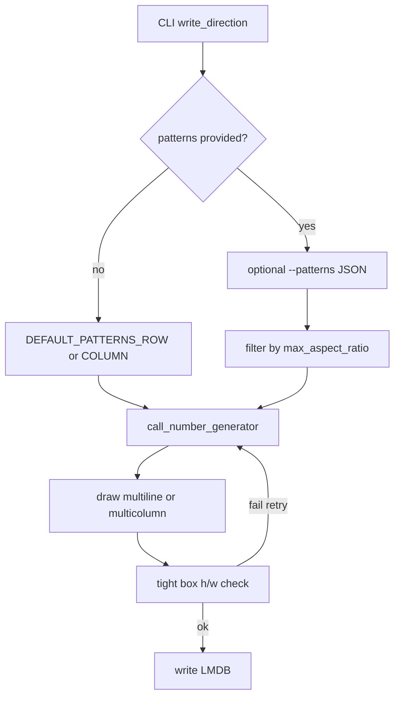

# 多行索书号识别 LMDB 生成器

实现：[`callnumber_multiline_lmdb.py`](../text_renderer/pipelines/callnumber_multiline_lmdb.py)  
按列绘制：[`callnumber.py`](../text_renderer/renderers/callnumber.py) 中的 `draw_fitted_multicolumn_text`  
迭代记录：[UPDATES.md](UPDATES.md)

用于生成多行/多列索书号识别切片并写入 LMDB。每条记录包含图像、完整文本标签、四点文本框、分数、文件名和字体文件名。

## 目标与设计取舍

识别切片最终 `h/w` 不能偏高瘦。用**可见的默认布局表**表达“会生成什么结构”，而不是：

- 事后按高宽比强制旋转纠偏（旧 `threshold_l/r`）；
- 或让用户理解一套复杂的自动布局搜索。

已定决策：

| 层级 | 做法 |
| --- | --- |
| **主路径** | `_DEFAULT_PATTERNS_ROW` / `_DEFAULT_PATTERNS_COLUMN` 人工维护，保证在目标阈值（约 1.2）下合格 |
| **辅路径** | `--max-aspect-ratio` 约束自定义 `--patterns`；渲染后紧框 `h/w` 复检兜底 |
| **按列书写** | 每条生成串先横排绘制，再整体逆时针旋转 90°，多列从左到右排列（字形侧躺） |
| **整图旋转纠偏** | 已删除 L/R 必转；`--rotation-prob` 默认 `0`，仅可选增强，且旋转后仍须 `h/w <= max_aspect_ratio` |

为什么默认用两套表，而不是「统一大表 + 启动自动过滤」：

- row / column 下同一组 `lengths` 是否合格往往相反，分表更诚实；
- 改结构 = 改列表，日常心智负担最低；
- 自动过滤只留给用户显式传入的 `--patterns`，避免默认表里堆满“永远采不到”的项。

## 用户心智模型（两个常用旋钮）

1. `--write-direction {row,column}`：按行写还是按列写（默认 `row`）
2. 默认不用改阈值；需要时加 `--max-aspect-ratio`（默认 `1.2`）护住自定义结构

日常改数据分布：编辑代码里对应方向的 `_DEFAULT_PATTERNS_*` 即可。

## 快速开始

```powershell
# 按行书写（默认）：使用 _DEFAULT_PATTERNS_ROW
python -m text_renderer.cli callnumber-multiline --write-direction row --num 10000 --out .\cn_row_lmdb

# 按列书写：使用 _DEFAULT_PATTERNS_COLUMN
python -m text_renderer.cli callnumber-multiline --write-direction column --num 10000 --out .\cn_col_lmdb
```

默认使用 `learned` 策略和内置索书号分布模型。生成完成后默认抽取 50 条到 `samples/` / `ori_data/`；`--sample-count 0` 可关闭。输出目录已存在时需加 `--overwrite`。

## `lengths` 语义

生成器仍返回 `lines: list[str]`，标签仍为空格拼接。方向只影响**怎么画**和**怎么估高宽比**：

| 方向 | 每个非零 `lengths[i]` | 非零项数 | 估算 `h/w` |
| --- | --- | --- | --- |
| `row` | 第 i 行横排字符数 | 行数 | `n_rows / max_line_len` |
| `column` | 第 i 列竖排字符数 | 列数 | `max_col_len / n_cols` |

示例（阈值 `1.2`）：

| lengths | row（估算） | column（估算） |
| --- | --- | --- |
| `[1,1,1]` | 拒绝（3.0） | 接受（≈0.33） |
| `[3,3,0]` | 接受（≈0.67） | 拒绝（1.5） |
| `[2,2,2]` | 拒绝（1.5） | 接受（≈0.67） |
| `[4,4,0]` | 接受（0.5） | 拒绝（2.0） |

因此默认表必须分方向，不能共用一张再过滤。

## 数据流



## 默认 patterns（源码常量）

未传 `--patterns` 时，按 `write_direction` 选用下表（与代码保持一致；改结构改这里）：

```python
# 人工保证：row 下 rows/max_len 大约 <= 1.2
_DEFAULT_PATTERNS_ROW = [
    {"lengths": [3, 3, 0], "weight": 2.5},
    {"lengths": [4, 4, 0], "weight": 2.0},
    {"lengths": [3, 0, 3], "weight": 2.5},
    {"lengths": [2, 1, 0], "weight": 1.5},
    {"lengths": [2, 0, 2], "weight": 1.5},
]

# 人工保证：column 下 max_len/n_cols 大约 <= 1.2
_DEFAULT_PATTERNS_COLUMN = [
    {"lengths": [2, 2, 2], "weight": 1.5},
    {"lengths": [2, 2, 0], "weight": 2.5},
    {"lengths": [1, 1, 1], "weight": 1.0},
    {"lengths": [2, 1, 0], "weight": 1.5},
    {"lengths": [3, 3, 3], "weight": 1.0},  # 3/3=1.0
]
```

`--patterns` 的 argparse 默认值为 `None`（未传才注入分方向默认），以便区分“显式传入”与“使用默认”。

## 自定义 `--patterns` 与护栏

```powershell
python -m text_renderer.cli callnumber-multiline `
  --write-direction row `
  --max-aspect-ratio 1.2 `
  --patterns '[{"lengths":[3,3,0],"weight":2},{"lengths":[1,1,1],"weight":1}]' `
  --num 10000
```

上例在 `row` 下会打印并丢弃 `[1,1,1]`（估算 3.0 > 1.2）；若全部被滤掉则启动报错。

规则：

- `lengths` 最多 3 个非负整数；`0` 表示省略该槽位
- `weight` 为相对采样权重
- **默认表**：信任人工，启动时不强制过滤（由测试保证约 ≤ 1.2）
- **用户 `--patterns`**：启动时按方向估算过滤并打印被丢项
- **采样**：生成结果估算超限则重试（上限 50）
- **渲染后**：紧框 `h/w > max_aspect_ratio` 则本条不写库、重试

相关函数：`layout_aspect_from_lengths` / `layout_aspect_from_lines` / `filter_patterns_by_aspect`。

## 按列绘制

`draw_fitted_multicolumn_text`：

1. 将每个 `line` **横排**画到透明条带上；
2. 对该条带 **逆时针旋转 90°**（字形侧躺，成竖直列）；
3. 多列从左到右排布，整体在贴纸框内居中并适配字号。

这与「逐字正立往下叠」不同：拉丁索书号按列书写时字符本身需要旋转。

画布最小宽高按方向对偶估算：`row` 用最长行宽 × 行数；`column` 用列数 × 最长列高（旋转后的几何）。

## CLI 参数摘要

| 参数 | 默认 | 含义 |
| --- | --- | --- |
| `--write-direction` | `row` | `row` / `column` |
| `--max-aspect-ratio` | `1.2` | 布局与紧框 `h/w` 上限 |
| `--patterns` | 未传 → 分方向默认表 | JSON 结构列表 |
| `--rotation-prob` | `0` | 可选增强；旋转后仍须达标 |
| `--generator-strategy` | `learned` | `learned` / `grammar` |
| `--scale-min` / `--scale-max` | `1.6` / `2.2` | 画布尺度 |
| `--output-scale` | `0.8` | 最终缩放 |
| `--side-ratio` | `1.0` | 紧框外扩 |
| `--noise` | off | 额外噪声模糊 |
| `--sample-count` | `50` | 生成后可视化条数；`0` 关闭 |
| `--overwrite` | off | 允许覆盖已有输出目录 |

**已删除**：`--rotation-aspect-ratio-threshold-l` / `--rotation-aspect-ratio-threshold-r`。

## 图像合成步骤

1. 按策略生成文本单元列表  
2. 按 `row`/`column` 画贴纸文字  
3. 背景纹理 / 可选噪声  
4. 按文字紧框扩展背景后裁剪  
5. 紧框 `h/w` 复检；超限则重试  
6. 可选旋转（见上）  
7. `--output-scale` 缩放后写入 LMDB  

## 索书号生成策略

策略接口：[`call_number_generator.py`](../text_renderer/corpus/call_number_generator.py)。`generate()` 只负责产出字符串列表；几何约束留在 pipeline。

### `learned`

内置分布模型：两行/三行比例、各行长度、字母数字模板、年份与可选 `v`/`.v` 等。不读外部索书号文件。

### `grammar`

通用语法：首行字母+数字、二行数字、三行数字（可加 `v`/`.v`）；长度为 `0` 的槽位省略。

## 标签和 LMDB 字段

标签为各单元文本空格拼接，例如 `I12 34=5 2024`。第三行中的 `v` / `.v` 原样保留。

| 字段 | 含义 |
| --- | --- |
| `image` | BGR 识别切片 |
| `transcription` / `label` | 完整文本 |
| `points` / `bbox` | 文本四点框 |
| `scores` | `1` |
| `file` | 如 `image-000000001_0_0.jpg`（末段为旋转角度） |
| `font` | 字体文件名 |

字体每 20 条样本切换一批；按路径和字号缓存。

## 非目标（本次范围）

- 不把几何约束塞进 `call_number_generator`
- 不做自动布局搜索 / 复杂像素宽高预测
- 不在索书号 **detection** 流水线同步本套 row/column 改造

## 验证

```powershell
python -m text_renderer.cli callnumber-multiline --help
python -m pytest text_renderer/tests/test_callnumber_multiline_aspect.py -q
```

验收对照：

1. 不传 `--patterns`：`row`/`column` 分别只采样对应默认表  
2. `--help` 中不再出现 L/R 旋转阈值参数  
3. 自定义仅含超限结构时启动失败且信息可读  
4. 单测覆盖 row/column 对偶估算与过滤行为  
